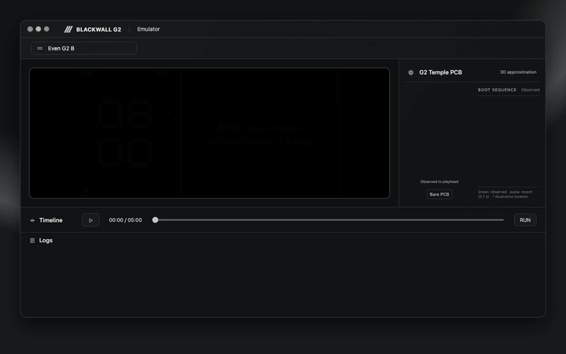
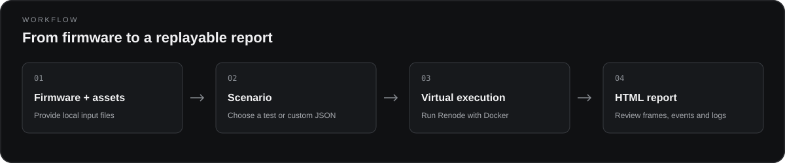
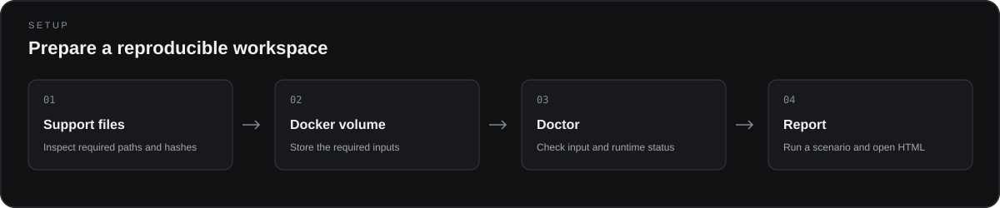
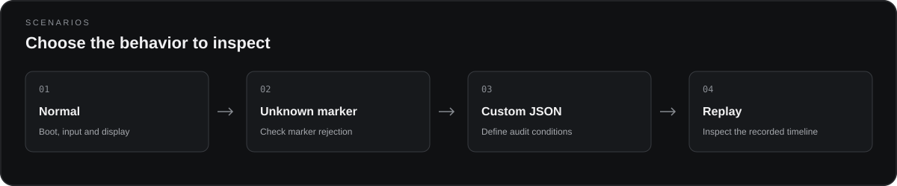
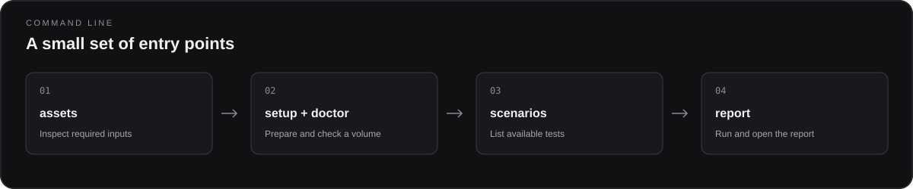
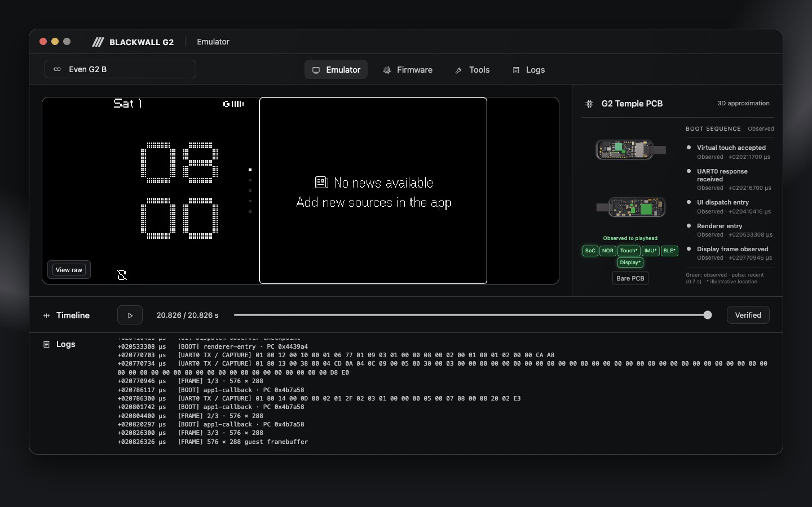
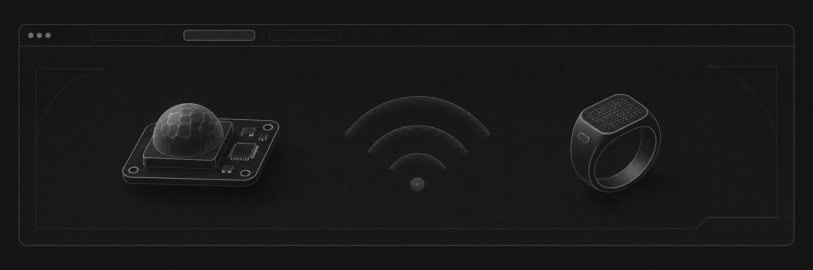

<div align="center">

# BLACKWALL

**Even Realities G2 firmware emulator**

Explore firmware boot, display changes, and virtual hardware events in one place.


[Getting started](#getting-started) · [Booting stock firmware](#booting-stock-firmware) · [Scenarios](#scenarios) · [Commands](#commands) · [Video](docs/media/desktop-emulator-demo.mp4)

[](docs/media/desktop-emulator-demo.mp4)

[Watch the desktop video](docs/media/desktop-emulator-demo.mp4) · [View the screenshot](docs/media/desktop-report.png)

</div>



## Getting started



Blackwall runs Renode in Docker and generates an HTML report. You need Python 3.9 or later and Docker. Prepare the stock G2 2.4 images, pinned model and memory snapshots, and Renode Docker image separately. Firmware and private assets are not included in this repository.

Create a Docker volume once by specifying the required files. Replace the example paths with the locations of your files.

```sh
python3 blackwall assets --source /path/to/support-files
python3 blackwall setup --source /path/to/support-files --boot-image /path/to/boot.bin --main-image /path/to/main.bin
python3 blackwall doctor
```

`--source` points to the directory containing the model files and memory snapshots specified by the profile. `assets` displays the required paths and hashes. If the files are already present in an existing research environment, the bootloader and main image options can be omitted. The default volume is named `blackwall-assets`; use `--volume` to choose another name. Existing volumes are never overwritten.

On Windows, you can use `python` instead of `python3`. See [preparing the files and Docker image](docs/getting-started/emulator-report-quickstart.md).

## Booting stock firmware

The default scenario executes the **original ARM binaries for the Even Realities G2 stock 2.4 bootloader and main firmware** on a virtual board. After setup, run:

```sh
python3 blackwall report --scenario normal --serve
```

You can also specify the images at run time. Only images matching the selected profile's size, hash, and vectors are accepted.

```sh
python3 blackwall report --scenario normal --boot-image /path/to/boot.bin --main-image /path/to/main.bin --serve
```

Open `http://127.0.0.1:8765/` to inspect the boot process and captured screens; press `Ctrl-C` to stop the server. Execution starts at the virtual bootloader entry and does not install firmware on physical glasses.

Reports and re-audit artifacts are stored in the directory printed by the command. Use `--output /path/to/new-folder` to choose a location. This directory contains copies of firmware and model inputs, so do not add it to the repository or share it.

## Scenarios



| Scenario | Description |
| --- | --- |
| [normal](docs/scenarios/normal.md) | Observe boot, virtual input, and display output |
| [unknown-boot-marker](docs/scenarios/unknown-boot-marker.md) | Verify rejection of an unknown boot marker |
| [Custom scenarios](docs/scenarios/custom-scenarios.md) | Add JSON audit conditions to a built-in scenario |

```sh
python3 blackwall scenarios
python3 blackwall report --scenario unknown-boot-marker --serve
python3 blackwall report --scenario-file scenarios/screen-boot.json --serve
```

## Commands



| Command | Purpose |
| --- | --- |
| `python3 blackwall assets --source /path/to/support-files` | Show required file paths and hashes |
| `python3 blackwall setup --source /path/to/support-files` | Store verified inputs in a new Docker volume |
| `python3 blackwall doctor` | Check the Docker volume and input files |
| `python3 blackwall scenarios` | List built-in scenarios |
| `python3 blackwall report --serve` | Generate a report and start a local server |
| `python3 blackwall report --help` | Show firmware, output, and other options |

Report timestamps use virtual time; some component locations in the 3D board model are estimates. No physical flashing or OTA is performed.

[Documentation](docs/README.md) · [Boot reproduction](docs/bootloader/original-boot-reproduction.md) · [Upstream projects and licenses](NOTICE.md) · [Work log](docs/data/work-log.tsv)

## Verified so far



The results below apply to the pinned inputs and virtual models described in each reference.

| Area | Verified behavior | Evidence |
| --- | --- | --- |
| Stock boot | Continuous execution from stock 2.4 original ARM bootloader reset through main firmware, UI, and display | [Boot completion audit](docs/bootloader/original-boot-completion-audit.md) |
| Main firmware | Service startup and UI wait/resume paths from main reset for stock 2.4, stock 2.3, and Faceclaw | [Main boot validation](docs/firmware/native-main-boot-acceptance.md) |
| Display and fonts | Original UI and font processing, 576×288 framebuffer output, and successive frames | [First screen](docs/bootloader/boot-family-first-screen.md) · [Post-screen lifecycle](docs/bootloader/boot-family-post-screen-lifecycle.md) |
| Touch input | Virtual touch through original handlers and UI commands to a visible frame change | [Touch input](docs/hardware/sensors-input/active-hud-touch-family-contract.md) |
| Ring input path | Original ring input reflected in the UI and display through a virtual opposite-temple UART relay | [Input validation](docs/research/input-acceptance.md) |
| Sensor input path | Virtual FIFO and interrupts consumed by the original sensor task, including numeric processing | [Sensor task](docs/hardware/sensors-input/sensor-task-consumption.md) |
| Reset | Reinitialization and UI/display recovery after virtual NVIC reset | [Reset validation](docs/hardware/power/active-board-reset-acceptance.md) |
| Bootloader and recovery | Virtual recovery, interruption, stock restoration, and version combinations across 12 specified criteria | [Final bootloader audit](docs/bootloader/bootloader-final-acceptance.md) |
| Report | Captured screens, events, logs, and a virtual board model displayed over time in HTML | [Desktop video](docs/media/desktop-emulator-demo.mp4) |
| Run tools | Pinned inputs stored in a Docker volume, normal and rejection scenarios, and capture re-auditing | [Volume workflow](docs/architecture/docker-volume-workflow.md) · [Scenarios](docs/scenarios/README.md) |

The stock boot and bootloader recovery results are limited to the virtual input/model combinations in the referenced documents. They do not establish full boot from the actual Boot ROM or physical device recovery.

## Future work



These are candidate improvements; their order and scope may change as evidence becomes available.

| Area | Remaining work |
| --- | --- |
| **IMU visualization and input** | Display acceleration, angular velocity, orientation, sample timing, FIFO, and interrupts; add motion scenarios. Separately validate sensor-fusion results and accuracy against real data. |
| **BLE testing and visualization** | Exercise connections, service discovery, GATT reads/writes, notifications, timeouts, and reconnection; display packets and state changes over time. |
| **R1 ring interaction** | Model ring connection states and confirmed input events, then verify their effect on the display. Keep the existing UART relay separate from direct R1 BLE. |
| **Even Realities official app communication** | Investigate available protocol evidence; test connection, synchronization, notifications, and errors; determine what can connect to the actual official app. |
| **3D PCB accuracy** | Obtain high-resolution images of both board sides and component identification evidence; improve shape, placement, and materials; distinguish confirmed locations from estimates. |
| **Full boot and device configuration** | Investigate the actual Boot ROM and early boot; model communication, power, and reset relationships between both temples and the charging case. |
| **Display and GPU model** | Expand font, image, and animation coverage, as well as GPU command, framebuffer, and interrupt models; investigate the accuracy of reference rendering. |
| **Storage, power, and recovery failures** | Test virtual MRAM/NOR partial failures, power loss, watchdogs, reboots, and version mismatches; record the point of failure. |
| **Firmware comparison and tests** | Compare compatibility, execution paths, frames, and events across stock, Faceclaw, and CFW candidates; explore scenarios with configurable inputs, timing, and expected results. |
| **Report observability** | Connect frames, packets, device states, and errors on the same virtual timeline; improve search, filtering, comparison, and event provenance. |
| **Setup and reproducibility** | Organize shareable model assets and provenance, Docker images, and input preparation; validate operating-system/CPU combinations and long-running stability. |

See the [emulator capability catalog](docs/architecture/emulator-capability-catalog.md) and [documentation](docs/README.md) for detailed research and existing validation scope.

## Disclaimer

Blackwall is an independent, experimental project and is not affiliated with or endorsed by Even Realities.

The emulator does not guarantee that firmware will behave the same way on physical hardware. Use it at your own risk. The authors are not responsible for any damage, data loss, or other issues arising from its use.
