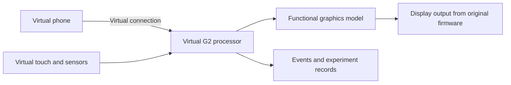

# BLACKWALL

**A laboratory for exploring how Even G2 firmware runs inside the glasses.**

Blackwall runs original G2 ARM firmware on Renode's Cortex-M55 and studies display, input, communication, and boot flows on virtual hardware.

> This is a research emulator. It does not guarantee physical-device installation or recovery safety, or precise reproduction of the entire chip.

## What you can explore

| Scene | Scope observed at the time |
| --- | --- |
| Display | 576×288 screen capture from original ARM execution of stock and Faceclaw main firmware |
| Input and connection | Original code consuming specified virtual touch, ring, and phone inputs |
| Boot and recovery | Original branches and recovery scenarios observed under explicit virtual models |

The first Faceclaw screen uses stock fallback. These are not results from executing the original Boot ROM or physical MRAM. Do not extend success for one profile to all firmware or physical glasses.

## Research for developers

- [Supported scope and limits](../architecture/emulator-capability-catalog.md)
- [Original display execution](../bootloader/boot-family-first-screen.md)
- [Bootloader and virtual recovery validation](../bootloader/bootloader-final-acceptance.md)
- [Faceclaw and stock comparison](../archive/faceclaw-stock-comparison-review.md)
- [Development environment](../getting-started/fresh-simulator-workspace.md)

## Next steps for this draft

Representative graphics, board visualization, and a reproducible startup procedure for external environments were in preparation. Firmware and personal device data are not included in the repository. The conditions and evidence for the table above are available in the linked documents.
